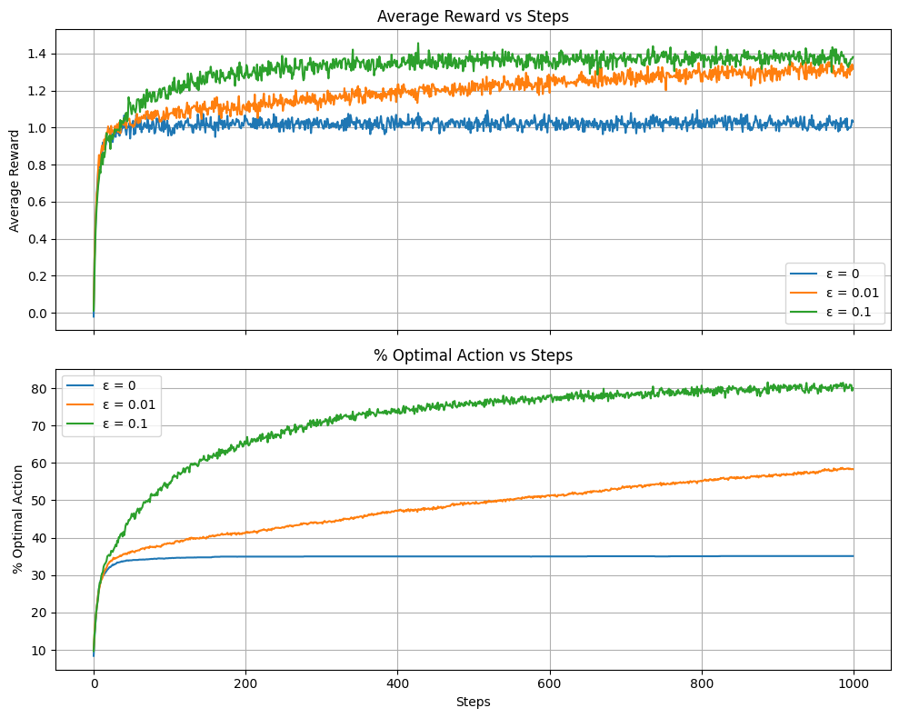
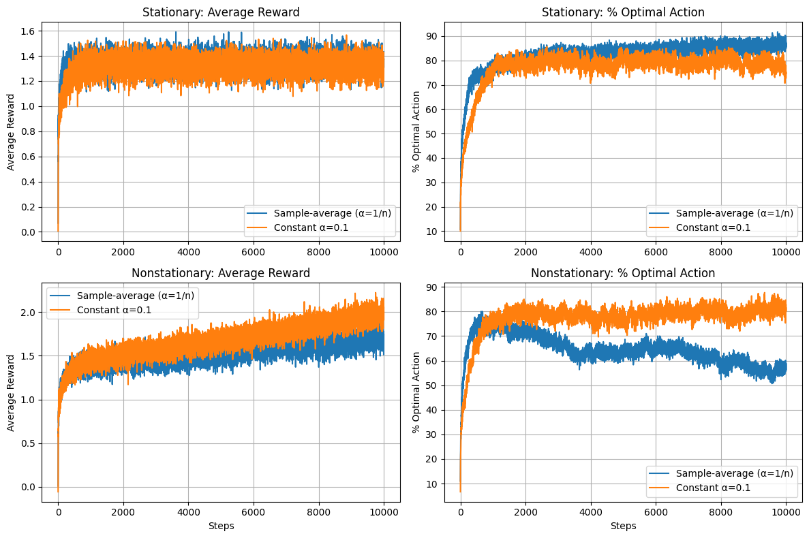
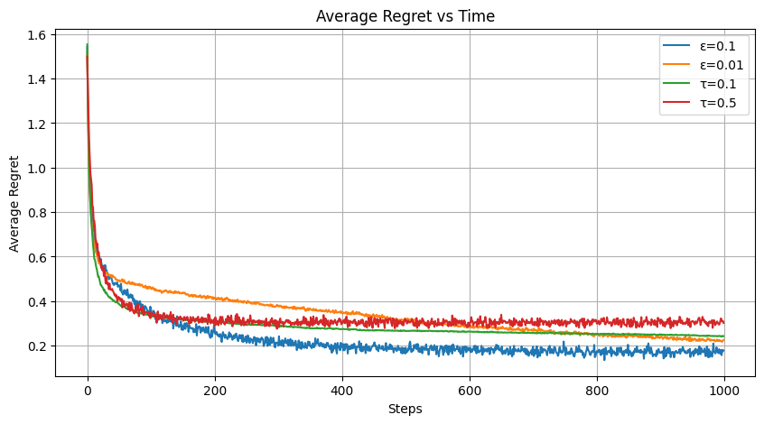
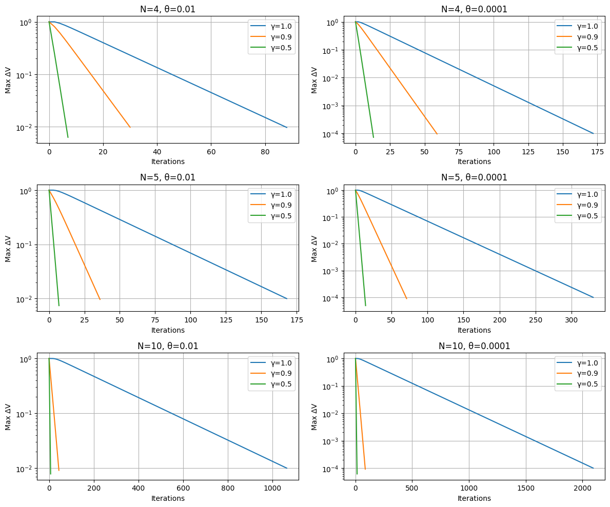

# Reinforcement Learning Labs

Lab notebooks on multi-armed bandits, exploration strategies, a contextual bandit news recommender (Lab 3, on its own branch), and dynamic programming, Monte Carlo and TD(0) on GridWorld. Each notebook is saved with its outputs and ends with my analysis of the results.

## Coursework

Labs for **Reinforcement Learning**, Semester 6 (Spring 2026), Plaksha University. The course project is in a separate repository, [rl-pandemic-policy-control](https://github.com/PrashamSheth/rl-pandemic-policy-control).

## Labs and results

| Lab | Notebook | Topic | Result |
|---|---|---|---|
| 1 | `lab01_multi_armed_bandit.ipynb` | 10-armed testbed: epsilon-greedy (Sutton and Barto Figure 2.2), the weighting of past rewards (Exercise 2.3), sample-average vs constant step size in stationary and nonstationary bandits (Exercise 2.5) | epsilon = 0.1 reaches about 80% optimal actions after 1,000 steps, against 58% for epsilon = 0.01 and 35% for greedy. Over 10,000 steps in a drifting (nonstationary) bandit, a constant step size keeps about 80% optimal actions, while sample averaging falls to about 57% |
| 2 | `lab02_epsilon_greedy_vs_softmax.ipynb` | epsilon-greedy (0.01, 0.1) vs SoftMax (tau = 0.1, 0.5): reward, % optimal action and regret | SoftMax lowers regret fastest early on; epsilon = 0.1 has the lowest regret (about 0.17) and 79% optimal actions by step 1,000 |
| 3 | on branch `lab03-original-submission` | Contextual bandit news recommendation: context detection, then epsilon-greedy, UCB and SoftMax bandits per user type | Kept as originally submitted; see below |
| 4 | `lab04_dp_mc_td_gridworld.ipynb` | Iterative policy evaluation, effect of gamma / theta / grid size, slippery moves, first- vs every-visit MC, MC control, batch TD(0) | Reproduces the classic 4 x 4 values (0, -14, -18, -20, -22). Batch TD gives V(A) = 2/3 where batch MC gives 0 |



*Lab 1: average reward and % optimal action for epsilon = 0, 0.01 and 0.1 (2,000 runs).*



*Lab 1, Exercise 2.5: sample average vs constant step size in stationary and nonstationary bandits (10,000 steps, 300 runs).*



*Lab 2: average regret over time for epsilon-greedy and SoftMax.*



*Lab 4: convergence of policy evaluation for different gamma, theta and grid sizes.*

## How to run

```
pip install -r requirements.txt
jupyter notebook
```

## Notes on the cleanup

- **Lab 1:** Exercise 2.5 was run for 1,000 steps, too short for the nonstationary random walk to matter, so it did not show the effect the exercise asks for. It now runs 10,000 steps, as the exercise specifies. The function that plots the arms' reward distributions was defined but never called; it is now called.
- **Lab 2:** unchanged apart from the analysis, which now includes the values read from the plots.
- **Lab 4:** "batch TD(0)" applied each update immediately, which is online TD replayed many times and settles at 0.701 instead of 2/3. It now accumulates the increments over the whole batch before applying them. The Monte Carlo estimate from given episodes (Q2.3) is merged in from a separate draft notebook.
- Lab 2 also existed as a duplicate inside the Lab 1 notebook. Only the separate notebook is kept.

## Lab 3

Lab 3 (contextual bandit news recommender) is not on the main branch. My submission from February 2026 is kept as handed in, with the course's assignment brief and starter data, on the [`lab03-original-submission`](../../tree/lab03-original-submission) branch and in its own repository, [lab3-contextual-bandit](https://github.com/PrashamSheth/lab3-contextual-bandit).
